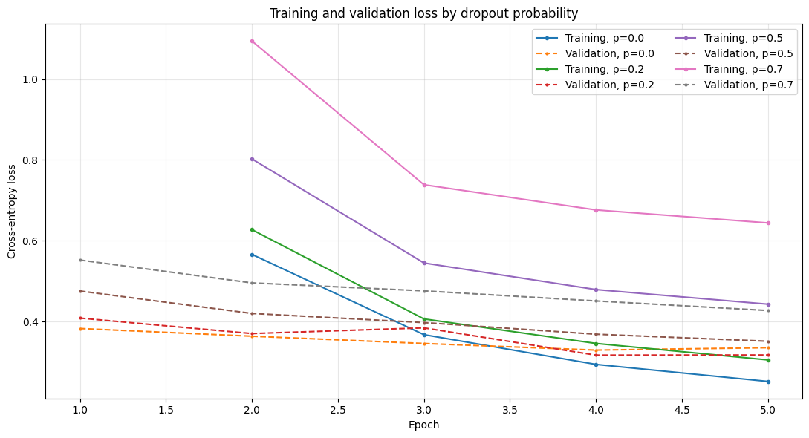
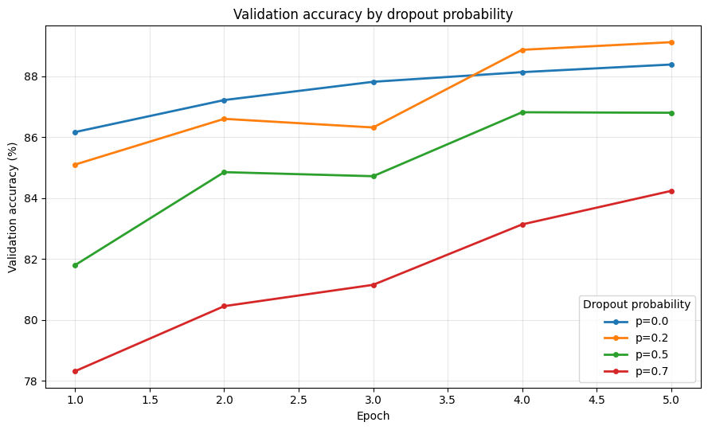
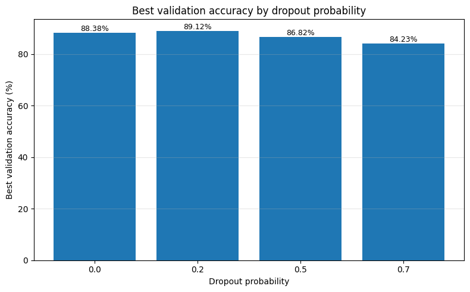

# Dropout: Teaching a Neural Network Not to Memorise
### A controlled Fashion-MNIST experiment with PyTorch Lightning

## Can a neural network learn too much?

When training a deep learning model, we usually want it to achieve high accuracy. However, a model can perform well on examples it has already seen and still struggle with new images. This is called **overfitting**. Instead of learning patterns that generalize, the model may become too dependent on details specific to its training data.

One technique used to address overfitting is **dropout**. During training, dropout randomly disables some activations in a neural network. This encourages the network to learn useful patterns that do not depend on only a few activations.

But does stronger dropout always improve performance? If too many activations are disabled, could the network struggle to learn useful features?

This experiment investigates the question: **How does changing dropout probability affect overfitting and validation performance in a small convolutional neural network (CNN) trained on Fashion-MNIST?** I compare dropout probabilities of 0.0, 0.2, 0.5, and 0.7 while keeping the other experimental settings fixed.

## What is dropout?

Dropout is a regularization technique. Regularization refers to methods that help prevent a model from relying too heavily on patterns that work only for the training examples. The dropout probability, \(p\), controls the chance that an activation is set to zero during training.

Conceptually, dropout can be written as

\[
\tilde{h} = h \odot m
\]

where \(h\) is a vector of activations, \(m\) is a random mask, and \(\odot\) means element-wise multiplication. In standard inverted dropout, the retained activations are also scaled during training so that their expected magnitude is preserved.

If \(p=0.2\), approximately 20% of the activations handled by the dropout layer are disabled in a training pass. At \(p=0.5\), about half are disabled. With \(p=0.0\), dropout has no effect. During evaluation, dropout is turned off and all activations are used.

The network should not become overly dependent on particular activations. Too little dropout may provide limited regularization, while too much can make learning harder. That makes dropout probability useful to test experimentally.

## Experiment setup

### Dataset

I used Fashion-MNIST, a dataset of 28 × 28 grayscale clothing and footwear images across ten categories, including trousers, dresses, sneakers, and bags. The official training split contains 60,000 images. The notebook creates a deterministic validation split of 6,000 images and uses a 10,000-image subset of the remaining training examples for this run. The official test split is not used to select a dropout setting.

### Model and controlled variables

The model is a small CNN with two convolutional blocks containing 32 and 64 channels. The blocks use batch normalization, ReLU activations, and max pooling. The classifier flattens the extracted features, uses dropout, maps them to a hidden layer of 128 units, applies dropout again, and produces ten class scores.

The four settings are:

| Setting | Value |
|---|---|
| Dropout probabilities | 0.0, 0.2, 0.5, 0.7 |
| Dataset | Fashion-MNIST |
| Training subset | 10,000 images |
| Validation set | 6,000 images |
| Optimizer | Adam |
| Learning rate | 0.001 |
| Batch size | 64 |
| Epochs | 5 in this run |
| Random seed | 42 |
| Activation | ReLU |
| Loss function | Cross-entropy |

I used PyTorch Lightning to organize training and record metrics. The architecture, dataset split, optimizer, learning rate, batch size, number of epochs, and seed were held fixed. Only dropout probability changed. Each run records training loss, validation loss, training accuracy, and validation accuracy for every epoch.

This notebook configuration uses a subset of the available training data and five epochs to keep the experiment relatively quick. The results therefore describe this particular setup, rather than the best performance the architecture could achieve with more data or training time.

## Results

### Figure 1 — Training and validation loss

*Figure 1. Training (solid lines) and validation (dashed lines) cross-entropy loss by epoch for dropout probabilities 0.0, 0.2, 0.5, and 0.7. Both axes should be labelled and the legend should identify each setting.*

The saved notebook results show that the no-dropout model ended with training loss 0.2517 and validation loss 0.3352. With dropout 0.2, the final training loss was 0.3049 and validation loss was 0.3171. The 0.5 and 0.7 settings had higher final validation losses of 0.3512 and 0.4272, respectively. In this short run, dropout 0.2 had the lowest final validation loss. The curves should be read together: a lower training loss alone is not enough to establish better generalization.

### Figure 2 — Validation accuracy over epochs

*Figure 2. Validation accuracy by epoch for each dropout probability. The horizontal axis is epoch and the vertical axis is validation accuracy.*

The highest validation accuracy in the saved notebook output was 89.12%, achieved with dropout probability 0.2 at epoch 5. The no-dropout baseline reached 88.38% at epoch 5. Dropout 0.5 reached its best result of 86.82% at epoch 4, while dropout 0.7 reached 84.23% at epoch 5. The curves show that increasing dropout beyond 0.2 did not improve validation accuracy in this run.

### Figure 3 — Best validation accuracy comparison

*Figure 3. Highest validation accuracy observed during the experiment for each dropout probability. The comparison uses validation metrics, not test accuracy.*

The 0.2 dropout setting had the highest validation accuracy at 89.12%, while 0.7 had the lowest at 84.23%. The difference was 4.89 percentage points. The no-dropout baseline scored 88.38%, so dropout 0.2 was 0.74 percentage points higher. This is a modest improvement, and it should be interpreted alongside the learning curves rather than on its own.

## Discussion

The experiment tests whether dropout changes the balance between learning the training data and generalizing to unseen validation examples. The results partly supported my expectation that dropout can help control overfitting: a small amount of dropout improved validation accuracy, but stronger dropout reduced it.

The configuration with dropout probability 0.2 achieved the best validation accuracy of 89.12%, compared with 88.38% for the no-dropout baseline. Its final validation loss was also lower (0.3171 versus 0.3352). At 0.5 and 0.7 dropout, final training accuracy fell to 83.22% and 75.81%, and validation accuracy fell to 86.80% and 84.23%. This pattern is consistent with stronger dropout making it harder for the network to fit the training task within only five epochs. It does not prove that the same setting will be best in a longer run or on another dataset.

A possible explanation is that moderate dropout discourages dependence on particular activations, while high dropout can make learning harder. The measured results—not theory alone—must determine which setting performs best.

There are several limitations. First, the current run uses 10,000 training images and five epochs, so it may not represent performance with the full training split or longer training. Second, only one random seed was used, and random initialization or data order can affect the results. Third, the experiment uses one CNN architecture and one dataset. Finally, the best validation accuracy across epochs can be affected by ordinary fluctuations.

A stronger follow-up would use the full training split, train for more epochs, and repeat every dropout setting across three to five seeds. Reporting mean and standard deviation would help show whether the differences are consistent rather than due to randomness.

## Takeaways

1. **Dropout probability matters.** It controls how many activations are randomly disabled during training and can affect learning and generalization.
2. **Learning curves matter.** Training loss, validation loss, and validation accuracy reveal more than a single final score and can help identify possible overfitting.
3. **The best setting is empirical.** A dropout probability that works well for one dataset and model may not be best elsewhere. Controlled experiments are needed before drawing conclusions.

The lesson is that hyperparameters should be compared under controlled conditions and conclusions based on validation results.

## Reproducibility and AI assistance

The notebook used for this experiment is available at [`dropout_fashion_mnist_experiment.ipynb`](./dropout_fashion_mnist_experiment.ipynb). The figures included above are extracted from the saved outputs in the uploaded notebook. Before submission, rerun the notebook yourself and confirm that the metrics and figures match; upload the CSV metrics alongside the notebook if available.

**AI assistance disclosure:** I used ChatGPT to help organize the article and explain the structure of the experiment. I ran the experiment and will verify the interpretation against my measured results before submission.

## References

1. Srivastava, N., Hinton, G., Krizhevsky, A., Sutskever, I., & Salakhutdinov, R. (2014). *Dropout: A Simple Way to Prevent Neural Networks from Overfitting.* Journal of Machine Learning Research, 15, 1929–1958. https://jmlr.org/papers/v15/srivastava14a.html
2. PyTorch. *torch.nn.Dropout documentation.* https://docs.pytorch.org/docs/stable/generated/torch.nn.Dropout.html
3. Xiao, H., Rasul, K., & Vollgraf, T. (2017). *Fashion-MNIST: a Novel Image Dataset for Benchmarking Machine Learning Algorithms.* https://arxiv.org/abs/1708.07747
4. PyTorch Lightning documentation. https://lightning.ai/docs/pytorch/stable/
